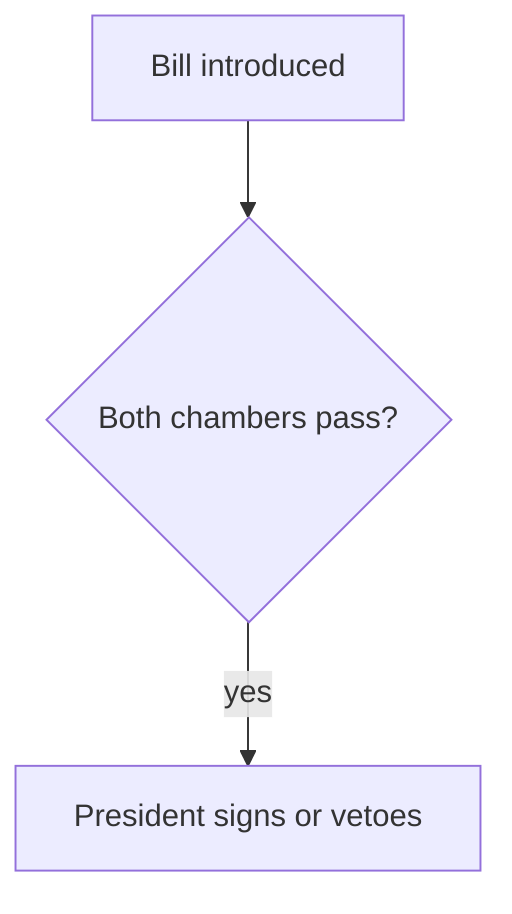

# Site

The Site is built from the vault with [Astro](https://astro.build), with [React](https://react.dev) for everything interactive, [Tailwind CSS](https://tailwindcss.com) v4 for styling, and [shadcn/ui](https://ui.shadcn.com) (Radix) primitives in `components/ui/`. Layouts, components, and styles live here; lessons and reference documents are Markdown in `vault/topics/<topic>/`. Pages contain only front matter, Markdown, and the Components below, so every page looks the same.

## Files

- Lesson: `lessons/NNNN-<slug>.md`, numbered from `0001`.
- Reference document: `reference/<slug>.md`.
- Simulation: `simulations/<name>.tsx` (see below).

## Front matter

Lesson:

```yaml
---
title: Calls and Puts
date: 2026-11-11          # created
updated: 2026-11-20       # optional, last meaningful change
lead: One or two sentences: the single win of this lesson.
minutes: 7                # optional
summary: A short line under the title   # optional
source:                   # the primary source
  title: "SEC: An Introduction to Options"
  url: https://www.investor.gov/…
further:                  # optional
  - title: …
    url: …
---
```

Reference document: `title`, `date`, optional `updated`, `lead`, and `sources` (a list of `title` + `url`). No other fields are allowed.

The Site adds the header, breadcrumbs, lesson number, previous / next links, sources, and the reminder to ask the tutor. Do not write them in the body.

## Body

- Markdown only: paragraphs, `##` and `###` headings, lists, tables, links, `**bold**`, `*italic*`, `` `code` ``, code blocks, `>` quotes, images. Raw HTML fails the build.
- Lesson sections are `##`, numbered `1.`, `2.`, …; the title is never repeated in the body.
- Link to other pages by path: `/topics/<topic>/lessons/<file name without .md>/`.
- Gloss a term on first use: `**separation of powers（权力分立）**`.

## Lesson shape

Every lesson follows the same order, so the learner always knows where they are:

1. `key[The core model]`: the whole lesson in two to four sentences, before any detail.
2. Numbered `##` sections, three to seven, each one idea. The last is usually a complete worked example (`steps`).
3. `check` last: one retrieval question on the core model.

Inside a section, pick the Component by the shape of the content, and keep plain paragraphs for the reasoning between them:

| The content is… | Use |
|---|---|
| Parts and how they connect: a structure, a flow, a cycle, a hierarchy, cause and effect | `diagram` |
| Two to four things of the same kind side by side | `cards`, or a table when they share attributes |
| An order of actions or a calculation | `steps` |
| A few numbers that carry the point | `stats` |
| New vocabulary | `terms` |
| A caveat, exception, or side remark | `note` |
| Something the reader must try with their own inputs | `simulation` |

- Draw a `diagram` in every lesson whose topic has structure or flow; one or two per lesson, each in the section it explains.
- At most two `key` per lesson, one `note` per section, no Component directly after another of the same kind.

A reference document has no `key`, numbering, or `check`: `##` sections by subject, written for lookup, with tables, `terms`, and `diagram`.


A component is a fenced block: `:::name[optional label]` … `:::`. An outer block that contains another uses one more colon (`::::`). Unknown components fail the build.

| Component | Use | Example |
|---|---|---|
| `key` | The idea to remember; at most two per lesson | `:::key[The core model]` … `:::` |
| `note` | A caveat or aside, as a quiet callout | `:::note` … `:::` |
| `cards` + `card` | Two to four parallel things; `foot` is optional | `::::cards` › `:::card[Article I]{foot="Can veto bills"}` with `### Title` and text › `::::` |
| `steps` | A procedure or worked example, as a numbered list | `:::steps` › `1. …` › `:::` |
| `stats` | Two to four key numbers, as a list | `:::stats` › `- **58%** had an unfavourable view` › `:::` |
| `terms` | Terms with meanings, as a list | `:::terms` › `- **Strike price（行权价）** The fixed price…` › `:::` |
| `check` | The retrieval question that ends a lesson; label defaults to "Check yourself" | `::::check` › question, `**the question in bold**` › optional choices as a task list › optional `:::answer` … `:::` › `::::` |
| `answer` | Hidden answer inside `check` | `:::answer` … `:::` |
| `diagram` | Structure, flow, or relationships, drawn hand-drawn style; label is the caption | `:::diagram[Checks and balances]` › one ` ```mermaid ` block › `:::` |
| `simulation` | The topic's own Simulation | `::simulation{name="payoff" title="Option payoff"}` |

Tables are plain Markdown tables; they scroll on narrow screens.

### Diagram

One [Mermaid](https://mermaid.js.org/intro/) code block: flowcharts, sequence, state, class, mindmap, timeline, and the other Mermaid types. The Site draws it in the reader's browser, hand-drawn, in the Design's colours, and redraws it in dark mode; do not set colours, themes, or `%%{init}%%` in the source.

- Prefer top-down (`flowchart TD`) for more than four nodes: the column is narrow, and a wide diagram scrolls.
- Keep labels short; quote labels with punctuation: `A["Bill (H.R.)"]`.
- A diagram supports the text; the text still states every fact it shows.

````markdown
:::diagram[How a bill becomes law]

:::
````

### Multiple choice

A task list inside `check` is a multiple-choice question: `- [x]` marks a correct option. The reader gets feedback on each attempt; a wrong pick never reveals the right one, and the `answer` explains. With several correct options the reader selects, then checks. Answers on the Site are not recorded and do not affect Mastery.

```markdown
::::check
**Which branch can veto a bill?**

- [ ] Congress
- [x] The President

:::answer
The President; Congress can override with two thirds of each chamber.
:::
::::
```

### Simulation

A Topic's own interactive piece, for what no Component can show, such as a payoff explorer. Write one only with a shell, and run `npm run build` before saving.

- File: `vault/topics/<topic>/simulations/<name>.tsx`, `<name>` in lowercase letters, digits, and hyphens; it default-exports a React component with no props.
- Build it from the Design: Tailwind classes with the theme colours (`bg-card`, `text-muted-foreground`, `border`, `text-brand`, `bg-tint`) and the primitives in `@/components/ui/`. No colours, fonts, or global styles of its own.
- It loads when scrolled into view. It must work with a keyboard and at a 375px width.

## Pronunciation

Every lesson and reference document has it; authors add nothing.

- Tap a word: its General American IPA (CMU Pronouncing Dictionary), its gloss if one follows it, and a play button.
- Each paragraph has a play button. Native-language glosses are not read aloud.
- Speech comes from Volcano Engine TTS (`seed-tts-2.0`), called directly from the browser with the reader's own API Key (or App ID and Access Token), asked for on first use and kept only in that browser's `localStorage`. The reader can choose the system voice instead. Audio is not cached.

## Look

- Light and dark: follows the system until the reader picks one in the header; the pick is kept in that browser.
- Fonts: Inter for text, JetBrains Mono for code, Kalam in diagrams; Chinese uses the system font.
- The Theme (`vault/theme.css`) sets only `--accent`; dark mode derives a lighter shade from it.

## Code

- `markdown.mjs` turns Components into HTML. Interactive ones become `data-island` elements that `islands/mount.tsx` mounts as React components when they scroll near the viewport.
- `components/ui/` holds shadcn/ui primitives; add more with `npx shadcn@latest add <name>`.
- `styles/global.css` is the Design: theme tokens and the styles of every Component.

## Commands

```bash
npm install
npm run dev     # preview at http://localhost:4321
npm run build   # build into dist/; fails on any rule above
npm run check   # type-check
```
